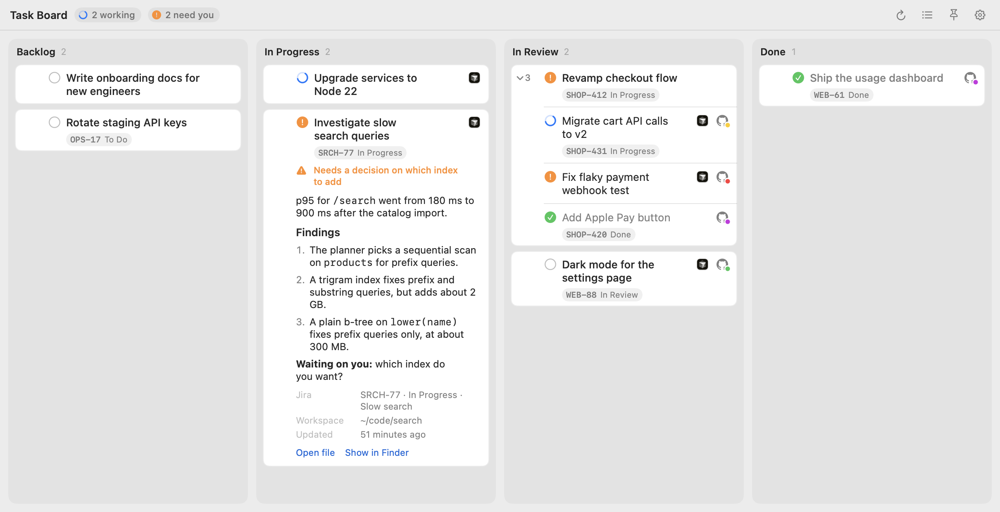
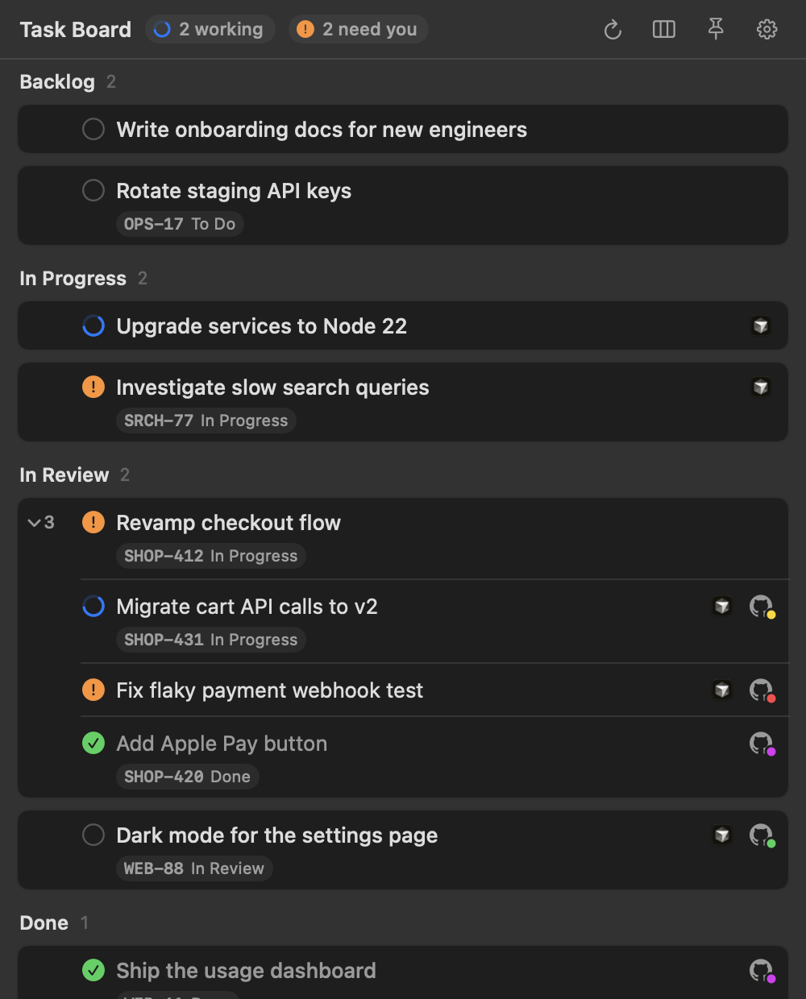

# Task Board

A small macOS menu bar board for keeping track of many coding agents at once.

Click the menu bar icon and a board drops down. Each card is one task: a short title, a status
icon, a button that opens the task's agent chat in Cursor or Claude, and a button that opens its
GitHub pull request. Tasks can have subtasks (one level deep), can be linked to a Jira issue or
stay local, and are stored as plain markdown files on your disk.



The app only reads. Agents write the task files through a small command line tool, and hooks in
Cursor or Claude keep each task's status in step with its agent, so the board fills in and updates
on its own.

## What you see

- **Status icon** on every card: a spinner while an agent is working, an orange mark when the task
  needs you (the agent finished its turn, is waiting for a permission, CI is failing, or changes
  were requested), a green check when done, an empty circle when nothing is happening.
- **Chevron and number** on the left of a task with subtasks. Click it to open them. The parent's
  icon is a summary of its subtasks: any that needs you wins, then any that is working.
- **Agent button**: opens the chat working on that task, in Cursor or in Claude. It shows that
  app's icon. Clicking it, or any other link on a card, closes the board and brings that app to
  the front. Pin the board to keep it open instead.
- **GitHub button**: opens the pull request. Its dot is green, yellow or red for CI, purple once merged.
- **Jira badge**: the issue key and its Jira status. Click it to open the issue.
- **Click a title** to open the task: why it needs attention, the full markdown description, and
  its links.
- **Menu bar icon**: counts of agents working and tasks that need you, across the whole board.
- A list layout, for a narrower window:

  

Settings (the gear, or right-click the menu bar icon) let you add, rename, reorder and remove
columns, choose the tasks folder, pick whether your agents run in Cursor or Claude, and connect
GitHub and Jira.

## Install

Requires macOS 14 or later and a Swift 5.9+ toolchain (Xcode or the command line tools).

```bash
scripts/build-app.sh --install
```

That builds `build/TaskBoard.app`, copies it to `/Applications` and launches it. Without
`--install` it only builds. The app is ad-hoc signed, not notarized.

To try it with sample data without installing anything:

```bash
TASKBOARD_HOME=examples/demo swift run TaskBoardApp --show-board
```

Setting it up for real means connecting your agent app, GitHub and Jira and checking each one. Those steps
are written out for an AI agent to follow with you in
[docs/work-computer-setup.md](docs/work-computer-setup.md).

## How tasks are stored

One markdown file per task or subtask, in `~/.taskboard/tasks` (changeable in Settings). The front
matter holds the fields the board shows; the body is the description.

```markdown
---
id: migrate-cart-api-to-v2
title: Migrate cart API calls to v2
status: working
parent: revamp-checkout-flow
jira: SHOP-431
pr: https://github.com/example/shop/pull/231
cursor_agent: 617e7b4c-1c4b-4cf2-8a98-d881f2dc99b5
---

Swap every `/v1/cart` call for the v2 client.
```

| Field | Meaning |
| --- | --- |
| `id` | Unique name. Defaults to the file name. |
| `title` | Shown on the card. At most 50 characters. |
| `status` | `idle`, `working`, `needs-attention` or `done`. |
| `attention` | Why it needs attention, shown when the task is opened. |
| `parent` | Id of the parent task. Leave out for a top-level task. |
| `column` | Pins the task to a column. Leave out to let it move on its own. |
| `jira` | Jira issue key. Leave out for a local-only task. |
| `pr` | Pull request URL. |
| `cursor_agent` | Id of the Cursor chat working on the task. |
| `claude_session` | Id of the Claude session working on the task, instead of `cursor_agent`. |
| `workspace`, `branch` | Where the agent works. Used to find the pull request for its branch. |

Fields the app does not know are left alone. You can edit the files by hand; the board updates as
soon as you save.

A task with no `column` places itself: the first column until an agent picks it up, then
In Progress, In Review once it has an open pull request, and Done when it is marked done or its
pull request merges. Which column plays each role is set in Settings.

## The `taskboard` command

The app keeps the command at `~/.taskboard/bin/taskboard`. Add that folder to your `PATH` if you
want to use it yourself.

```bash
taskboard add "Revamp checkout flow" --jira SHOP-412
taskboard add "Migrate cart API calls to v2" --parent revamp-checkout-flow
taskboard update migrate-cart-api-to-v2 --pr https://github.com/example/shop/pull/231
taskboard status migrate-cart-api-to-v2 needs-attention --reason "Which index do you want?"
taskboard list
```

Run `taskboard help` for everything else.

`taskboard doctor` tests each connection for real and says what to fix:

```text
Cursor
  ✓ The hooks are installed in ~/.cursor/hooks.json.
  ! No Cursor chat has reported yet, so the hooks are unproven.
      → Start a new agent chat in Cursor, send it a prompt, then run this again.

GitHub
  ✓ Signed in to github.example.com as you.
  ✓ Read https://github.example.com/team/app/pull/7: Open · checks passing.
```

`taskboard config` shows the connection settings, and `taskboard config agent <cursor|claude>`,
`github-server <host>`, `jira-site <url>` and `jira-email <email>` change them. The running app
picks changes up at once.

## Cursor and Claude

Pick the app your agents run in under Settings → Integrations → **Agents run in**, then click
**Install** below it. From a terminal, that is `taskboard config agent claude` (or `cursor`) and
`taskboard install-claude-hooks` (or `install-cursor-hooks`).

Installing adds a few hook entries to the app's own settings, next to any hooks you already have:
`~/.cursor/hooks.json` for Cursor, `~/.claude/settings.json` for Claude. A copy of Claude's file as
it was is kept beside it as `settings.json.before-taskboard`.

| When | Cursor hook | Claude hook | What it does |
| --- | --- | --- | --- |
| A chat starts | `sessionStart` | `SessionStart` | Gives the new agent its session id and asks it to file itself on the board. |
| You send a prompt | `beforeSubmitPrompt` | `UserPromptSubmit` | Marks the chat's task as working. A chat with no task yet gets one, titled from your prompt, so it shows up at once. |
| The agent's turn ends | `stop` | `Stop` | The task now needs you. |
| The agent asks for a permission | none | `Notification` | The task needs you now, mid-turn. |
| A tool finishes | none | `PostToolUse` | Clears that, once you have answered and the agent is moving again. |
| The chat closes | `sessionEnd` | `SessionEnd` | Clears a spinner that would otherwise spin forever. |

Filing works like this: the agent runs `taskboard list`, then decides where its work belongs. If
you asked it to carry on with an existing task it attaches to that task; if the work is a new piece
of an existing task it adds a subtask there; otherwise it creates a new top-level task. A chat that
is only a quick question it dismisses, which takes it off the board. It also records the pull
request it opens. The agent makes that judgement, so the app needs no model of its own.

An agent that reaches the end of its turn without having filed its chat is sent back once to do
it (Claude only). Until a chat is filed, its card is titled with the first words of your prompt.

The agent button opens these links:

| Chat | Link |
| --- | --- |
| Cursor | `cursor://anysphere.cursor-deeplink/agent?id=<chat id>` |
| Claude desktop app | `claude://claude.ai/epitaxy/<session id>` |
| `claude` in a terminal | `claude://resume?session=<session id>`, which opens it in the desktop app |

Things to know:

- Claude asks before it first runs the `taskboard` command in a chat. Choose to always allow it,
  or every new chat will stop to ask. The card shows "needs you" while it waits.
- Cursor has no hook for an agent stopped on an approval prompt, so in Cursor the card changes only
  when the turn ends. Cursor chats in Ask mode are left off the board.
- To see exactly what the app sends, run `touch ~/.taskboard/hooks.log`. Every hook call is then
  recorded there, prompts included, until you delete the file.
- Remove the hooks (Settings, or `taskboard uninstall-claude-hooks`) before deleting the app.

## GitHub

Pull request and CI status come from the [GitHub CLI](https://cli.github.com), so the app never
handles a GitHub token. Install `gh` and run `gh auth login`. When a task has a `workspace` and
`branch` but no `pr`, the app looks for that branch's pull request and writes the link into the task.

For GitHub Enterprise, sign the CLI in to your server with
`gh auth login --hostname github.example.com`, and enter the server under Settings → Integrations →
GitHub. **Test Connection** there shows which account the CLI is using on it. Pull requests on
different servers can sit on the same board; each is read from the server in its URL.

## Jira

Read-only. In Settings → Integrations enter your site (for example
`https://your-team.atlassian.net`), your account email and an
[API token](https://id.atlassian.com/manage-profile/security/api-tokens). For Jira Data Center,
leave the email empty and paste a personal access token. The token is stored in your Keychain. The
app only sends `GET` requests.

## Development

```bash
swift build
swift test
```

The package has three targets: `TaskBoardCore` (model, markdown storage, status roll-up,
integrations), `TaskBoardApp` (the menu bar app) and `taskboard` (the command).

To render the board to an image without opening it:

```bash
TASKBOARD_HOME=examples/demo swift run TaskBoardApp --snapshot board.png --remote examples/demo/remote.json
```

## Not built yet

- Creating or updating Jira issues from tasks. Jira is read-only for now.
- Editing tasks from the board. The board is a viewer.
- Telling that a Cursor agent is paused on an approval prompt mid-turn. Cursor has no hook for
  that; the task flips to "needs you" when the turn ends. Claude does report it.
- Cloud agents. Neither app runs your own machine's hooks for them.
